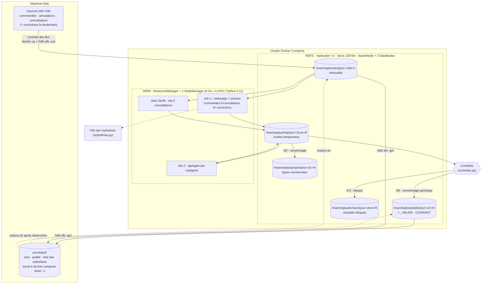

# A. Architecture et parcours des données

Le cluster fourni (Docker Compose) est une **démonstration mono-machine**, pas une infrastructure de production : un seul NodeManager, images amd64 émulées sur machine arm64, 8 Go alloués à Docker.

## Schéma

## Chemin d'un lot, de l'arrivée à la publication

| # | Étape | Où | Détail |
|---|---|---|---|
| 1 | **Contrôle des flux** | hôte | Le lot 1 exige commandes, annulations et consultations, non vides. Sinon : code 3, rien n'est écrit. |
| 2 | **Dépôt du brut** | HDFS `/marcheplus/brut/jour=J/lot=L` | Immuable. Un lot déjà présent n'est jamais réécrit : à l'identique = rejeu accepté ; différent = refus (code 4). |
| 3 | **Job 1** nettoyage + jointure + versions | YARN → `/tmp/.../job1` | Clé `(commande_id, ligne_id)`. Produit versions, lignes finales, rejets, orphelines, doublons, alertes, anomalies bloquantes. |
| 4 | **Job 2** agrégats | YARN → `/tmp/.../agg` | CA brut, annulations, net, nombre de commandes par catégorie. |
| 5 | **Jobs 3a/3b** consultations | YARN → `/tmp/.../cons`, `/top5` | Consultations distinctes par (catégorie, produit), puis top 5. |
| 6 | **File des orphelines** | hôte + `persistant/etat` | Règle des 3 lots, idempotente. |
| 7 | **Contrôles** | hôte | Voir « Quand un résultat est publiable ». |
| 8 | **Publication** | HDFS | Écriture dans `/tmp`, marqueur `_VALIDE`, **renommage** vers `/publie/jour=J/v=N`, puis mise à jour de `COURANT`. |
| 9 | **Copie durable** | `persistant/` | Version publiée, brut du lot, `COURANT`, état des orphelines. |

## Où se trouve quoi

| Donnée | Emplacement | Durée prévue | Remarque |
|---|---|---|---|
| **Données brutes** | HDFS `/marcheplus/brut/jour=J/lot=L`, copie dans `persistant/brut` | **90 jours** (politique du schéma d'origine) | **La purge à 90 jours n'est pas automatisée** dans le code livré. |
| Sorties temporaires | HDFS `/marcheplus/tmp` | Supprimées après publication réussie | En cas d'échec technique elles restent (voir les tests) : à purger à la main. |
| Zone propre (lignes versionnées) | HDFS `/marcheplus/propre` | Tant que la version publiée existe | Permet l'audit des corrections. **Non copiée dans `persistant/`** : elle se recalcule depuis le brut, et `versions_et_lignes.tsv` (publié, donc persisté) en contient le contenu. |
| **Résultats publiés** | HDFS `/marcheplus/publie`, copie dans `persistant/publie` | Durable (la durée à 2 ans relève de la section D du sujet) | Une version par recalcul ; les anciennes restent consultables. |
| Résultats bloqués | HDFS `/marcheplus/echecs` | À examiner puis purger | Jamais présentés comme officiels. |
| **Ce qui doit survivre à la destruction du cluster** | `environnement/persistant/` (hôte) | Durable | Seul élément hors cluster. |

## Composants qui interviennent

- **HDFS** (NameNode, 3 DataNodes) : stockage du brut, des intermédiaires et des résultats.
- **YARN** (ResourceManager, NodeManager) : exécution des quatre jobs Streaming.
- **Python 3.11** (sur NodeManager et NameNode) : mappers et reducers, standard library seulement.
- **Scripts hôte** : `pipeline.sh` (orchestration), `controles.py`, `orphelines.py`, `restore.sh`.
- **JobHistory/Timeline Server** : historique et logs agrégés (`historyserver`). Il n'y a **pas** de JobHistory Server MapReduce dans ce compose (voir décision T12).
- **Hive** : disponible mais **non utilisé** (décision T6).

## Quand un résultat est publiable

Un résultat n'est **officiel** que si **tout** ceci est vrai :

1. Les flux attendus sont présents et non vides.
2. **Lignes en entrée = lignes valides + rejets + doublons + orphelines** (commerce, avec corrections) et **consultations distinctes + doublons + rejets** = lignes en entrée.
3. **Brut − annulations = net**, recalculé indépendamment du job d'agrégation.
4. Le taux de rejets de chaque flux est ≤ 5 %.
5. Aucune anomalie bloquante (quantité annulée supérieure à la quantité commandée).
6. Le dossier a été renommé vers `/publie/jour=J/v=N` avec son marqueur `_VALIDE`, **et** `COURANT` pointe vers lui.
7. La copie dans `persistant/` est faite.

Si une condition échoue, le résultat va dans `/echecs`, la version officielle précédente (s'il y en a une) reste inchangée, et le pipeline sort en code 2.

## Reprise, relance, fichiers tardifs

| Situation | Comportement | Vérifié |
|---|---|---|
| Job tué ou en échec | Rien n'est publié ; le dernier résultat officiel reste en place | Oui (`yarn application -kill`) |
| Relance du même lot | Brut reconnu identique, nouveaux jobs ; si le résultat est identique à la dernière version, **aucune nouvelle version** | Brut identique : oui. « Résultat identique » : voir `tests_echec.md` |
| Sortie déjà existante | Chaque exécution écrit dans son propre `run=<horodatage>` ; le publié n'est jamais écrasé | Oui |
| Flux absent ou vide | Refus avant toute écriture (code 3) | Oui |
| Fichier corrompu | Blocage par le taux de rejets, résultat rangé dans `/echecs` | Oui |
| Corrections reçues le lendemain | Lot 2 : nouvelles versions de lignes, recalcul, publication de `v=2` ; `v=1` reste consultable | Oui |
| Destruction du cluster | `restore.sh` remet brut et publié depuis `persistant/`, vérifié par md5 | Oui |

**Pourquoi la réplication HDFS ne suffit pas à assurer la persistance** : les trois réplicas vivent dans le même cluster, donc dans les mêmes volumes Docker. `docker compose down -v` supprime les volumes des DataNodes **et** du NameNode d'un coup : la réplication protège contre la perte d'*un* DataNode, pas contre la destruction du cluster, une erreur d'administration ou une suppression logique (`hdfs dfs -rm`), qui se réplique aussi. Seule une copie hors cluster (`persistant/`, qui simule un stockage objet) survit.
